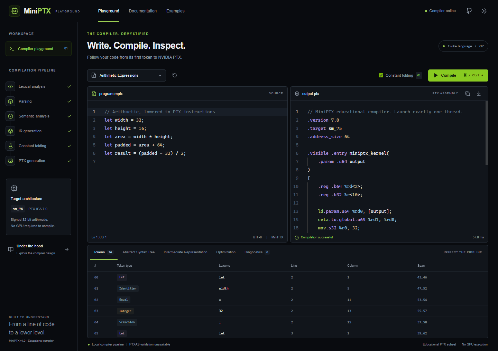

# MiniPTX

MiniPTX is a compiler frontend written in C++ that translates a restricted arithmetic language into NVIDIA PTX assembly. It includes an interactive web interface for inspecting the compilation process, from tokenization and parsing to intermediate representation, constant folding, and code generation. Every intermediate result displayed in the interface is produced directly by the C++ compiler executable.



## Overview

MiniPTX explores frontend compiler engineering by implementing a complete translation pipeline for a small, statically typed integer expression language. It illustrates how lexical analysis, recursive-descent parsing, AST construction, semantic validation, intermediate representation (IR) lowering, optimization, and target assembly emission fit together.

The project emphasizes transparency at each compilation boundary. Rather than treating code generation as a black box, the system exposes source spans, token streams, abstract syntax trees, linear three-address instructions, literal constant folding records, and emitted virtual-register PTX assembly.

## Features

- **Lexical analysis**: Scanner tracking byte offsets, 1-based line/column coordinates, typed tokens, and whitespace/comment preservation. Rejects non-ASCII and invalid characters.
- **Recursive-descent parsing**: Grammar enforcing operator precedence and left associativity for binary arithmetic, with AST depth bounded to prevent stack exhaustion.
- **Semantic analysis**: Single-scope symbol table with immutable bindings, declaration-before-use enforcement, duplicate/self-reference detection, and checked signed 32-bit arithmetic validation.
- **Three-address IR**: Intermediate representation with explicit instruction operations (`mov`, `add`, `sub`, `mul`, `div`), distinguishing temporary variables from source declarations.
- **Literal constant folding**: Bottom-up evaluation pass that folds constant subtrees while preserving language error semantics.
- **PTX assembly emission**: Generates NVIDIA PTX ISA 7.0 for `sm_75` targets, with 64-bit parameter loading, virtual register allocation, and global memory stores.
- **Subprocess execution service**: FastAPI backend wrapping the compiler CLI with bounded input limits, execution timeouts, concurrency controls, and structured error diagnostics.
- **Interactive web playground**: Next.js and Monaco editor interface with real-time compilation, interactive token tables, collapsible AST views, IR diff toggling, diagnostic error navigation, sample programs, and PTX download.
- **Optional assembler validation**: Checks whether NVIDIA `ptxas` is available locally and reports assembly status as passed, failed, or unavailable without fabricating results.

## Compiler Pipeline

The compiler follows a traditional frontend pipeline:


1. **Lexer**: Converts raw ASCII text into typed tokens (`Let`, `Identifier`, `Equal`, `Integer`, `Plus`, `Minus`, `Star`, `Slash`, `LParen`, `RParen`, `Semicolon`, `End`).
2. **Parser**: Implements recursive descent to produce an owned AST with typed expressions.
3. **Semantic Analysis**: Verifies that every identifier is declared before use, detects circular/self references, checks for duplicate declarations, and calculates literal values to verify signed 32-bit integer safety.
4. **IR Lowering**: Lowers the AST into three-address instructions using explicit temporaries (`%t0`, `%t1`, ...) and declaration targets (`$x`).
5. **Optimization**: Traverses literal expression trees bottom-up and folds constant operations into immediate values.
6. **PTX Generation**: Allocates virtual 32-bit registers (`%r0`, `%r1`, ...), emits parameter loading from kernel arguments, generates arithmetic instructions (`add.s32`, `sub.s32`, `mul.lo.s32`, `div.s32`), and stores results to global memory.

## Example

Given the source program:

```c
let x = 10;
let y = 20;
let result = x + y * 3;
```

The unoptimized three-address intermediate representation:

```text
$x = mov 10
$y = mov 20
%t0 = mul $y, 3
%t1 = add $x, %t0
$result = mov %t1
```

Emitted PTX kernel (`.version 7.0`, `.target sm_75`):

```ptx
// MiniPTX educational compiler. Launch exactly one thread.
.version 7.0
.target sm_75
.address_size 64

.visible .entry miniptx_kernel(
    .param .u64 output
)
{
    .reg .b64 %rd<2>;
    .reg .b32 %r<6>;

    ld.param.u64 %rd0, [output];
    cvta.to.global.u64 %rd1, %rd0;
    mov.s32 %r0, 10;
    st.global.s32 [%rd1+0], %r0; // x
    mov.s32 %r1, 20;
    st.global.s32 [%rd1+4], %r1; // y
    mul.lo.s32 %r2, %r1, 3;
    add.s32 %r3, %r0, %r2;
    mov.s32 %r4, %r3;
    st.global.s32 [%rd1+8], %r4; // result
    ret;
}
```

The `output` parameter is an address pointing to a device memory buffer. Each declared variable is stored consecutively in declaration order as an `int32` value.

## Tech Stack

- **Compiler**: C++17, standard library only, CMake 3.16+ build system.
- **Backend**: Python 3.11+, FastAPI, Pydantic v2, Uvicorn, pytest.
- **Frontend**: Next.js 16 (App Router), React 19, TypeScript 5.9, Tailwind CSS v4, Monaco Editor (served locally), Playwright.

## Project Structure

```text
MiniPTX/
├── compiler/
│   ├── CMakeLists.txt          # Compiler build configuration and test target
│   ├── include/
│   │   └── miniptx.hpp         # AST data structures, tokens, and compiler interface
│   ├── src/
│   │   ├── codegen.cpp         # PTX 7.0 code generation and virtual register allocation
│   │   ├── compiler.cpp        # Driver coordinating pipeline stages and JSON envelope
│   │   ├── ir.cpp              # Three-address IR lowering and constant folding
│   │   ├── lexer.cpp           # Tokenizer with line/column and byte offset tracking
│   │   ├── main.cpp            # Standalone CLI entrypoint reading stdin
│   │   ├── parser.cpp          # Recursive-descent parser with precedence climbing
│   │   └── semantic.cpp        # Symbol table, scope analysis, and arithmetic validation
│   └── tests/
│       └── compiler_tests.cpp  # Compiler unit tests and deterministic property checks
├── backend/
│   ├── app/
│   │   ├── main.py             # FastAPI endpoints and body limit middleware
│   │   ├── models.py           # Pydantic request and response schemas
│   │   ├── resource_runner.py  # POSIX resource limits wrapper (Linux/macOS)
│   │   └── service.py          # Compiler subprocess runner and ptxas invocation
│   ├── tests/
│   │   ├── test_api.py         # HTTP endpoint tests, edge inputs, and limits
│   │   ├── test_audit_regressions.py # Security and error regression test suite
│   │   └── test_codegen.py     # PTX register and store validation
│   ├── requirements.txt        # Backend dependencies
│   └── requirements-lock.txt   # Pinned dependency environment
├── frontend/
│   ├── app/                    # Next.js App Router pages and layout
│   ├── components/             # Monaco editor, AST tree, IR viewer, diagnostics
│   ├── lib/                    # API client and client-side models
│   ├── public/                 # Static assets and locally copied Monaco distribution
│   ├── scripts/                # Monaco local distribution copy script
│   ├── tests/                  # Playwright browser end-to-end test suite
│   └── package.json            # Frontend dependency manifest
├── examples/                   # Sample .mptx programs and API manifest
├── scripts/
│   ├── audit_differential.py   # Differential fuzzer against Python reference evaluator
│   ├── dev.py                  # Cross-platform development server runner
│   ├── reference_language.py   # Independent evaluator of language semantics
│   └── smoke.py                # Non-browser proxy and pipeline smoke test
├── docs/                       # Architecture, design, and verification records
└── LICENSE                     # Project license
```

## Getting Started

### Prerequisites

- C++17 compatible compiler (MinGW GCC 6.3+, GCC 9+, Clang 10+, or MSVC 2019+)
- CMake 3.16+
- Python 3.11+
- Node.js 20+ and npm

### 1. Clone the repository

```bash
git clone https://github.com/rizzit17/miniPTX.git
cd miniPTX
```

### 2. Build the C++ compiler

On Windows (PowerShell with MinGW):

```powershell
cmake -S compiler -B build -G "MinGW Makefiles"
cmake --build build -j 4
```

On Windows (Visual Studio):

```powershell
cmake -S compiler -B build
cmake --build build --config Release
```

On Linux or macOS:

```bash
cmake -S compiler -B build -DCMAKE_BUILD_TYPE=Release
cmake --build build --parallel
```

The resulting executable will be placed in `build/miniptx` (or `build/miniptx.exe` / `build/Release/miniptx.exe`).

### 3. Set up the backend

```bash
python -m venv .venv

# Windows:
.\.venv\Scripts\python.exe -m pip install -r backend/requirements.txt

# Linux/macOS:
.venv/bin/python -m pip install -r backend/requirements.txt
```

### 4. Set up the frontend

```bash
# Windows:
npm.cmd --prefix frontend ci

# Linux/macOS:
npm --prefix frontend ci
```

### 5. Launch the application

Use the provided launcher script to start both services concurrently:

```bash
# Windows:
.\.venv\Scripts\python.exe scripts/dev.py

# Linux/macOS:
.venv/bin/python scripts/dev.py
```

The web interface will be available at **http://127.0.0.1:3000** and the API documentation at **http://127.0.0.1:8000/docs**.

To run with a Next.js production build:

```bash
npm.cmd --prefix frontend run build
.\.venv\Scripts\python.exe scripts/dev.py --production
```

## Testing

The project contains automated test suites at multiple levels of the system:

### Compiler unit tests

Runs 32 test cases including parser precedence, left associativity, symbol checks, arithmetic overflow detection, boundary conditions, and 250 deterministic arithmetic property tests:

```bash
ctest --test-dir build --output-on-failure
# Or directly:
./build/compiler_tests
```

### Differential compiler testing

Compares the compiler's behavior, IR, and constant folding against an independent Python reference interpreter over 600 program invocations:

```bash
.\.venv\Scripts\python.exe scripts/audit_differential.py --compiler build/miniptx.exe
```

### Backend tests

Exercises API endpoints, input boundary checks, timeout handling, and PTX generation:

```bash
.\.venv\Scripts\python.exe -m pytest -v
```

### Frontend type checking and build verification

```bash
npm.cmd --prefix frontend run typecheck
npm.cmd --prefix frontend run build
```

### Browser end-to-end tests

With the backend and frontend servers running, execute the Playwright test suite:

```bash
npm.cmd --prefix frontend test
```

## Limitations

- **Language scope**: The source language supports only immutable signed 32-bit integer declarations (`let x = ...;`). Mutable assignment, control flow (`if`, `while`), functions, arrays, and floating-point operations are not supported.
- **Arithmetic domain**: Operations are restricted to addition, subtraction, multiplication, and integer division. Any operation resulting in 32-bit overflow or division by zero terminates compilation with a diagnostic.
- **Optimization scope**: The optimizer performs bottom-up literal constant folding only. It does not perform cross-declaration constant propagation, common subexpression elimination, or dead code elimination.
- **PTX target**: Code generation assumes 64-bit addressing and targets PTX ISA 7.0 for `sm_75` (Turing architecture). It does not dynamically adjust to other GPU compute capabilities.
- **GPU execution**: MiniPTX does not load or execute the generated PTX on physical GPU hardware. Running kernels requires an external CUDA runtime harness to allocate memory and launch the grid.
- **PTXAS dependency**: Validation of generated PTX into binary CUBIN format requires an installed NVIDIA CUDA Toolkit with `ptxas` accessible on the system.

## Possible Extensions

- Support for user-defined functions and call frames.
- Conditional expressions and basic block control-flow graphs.
- Static single assignment (SSA) form with phi nodes.
- Constant propagation across variable bindings.
- Multi-architecture PTX targeting (`sm_70`, `sm_80`, `sm_90`).
- Driver API integration for executing generated kernels on an attached NVIDIA GPU.

## License

This project is licensed under the [MIT License](LICENSE).
